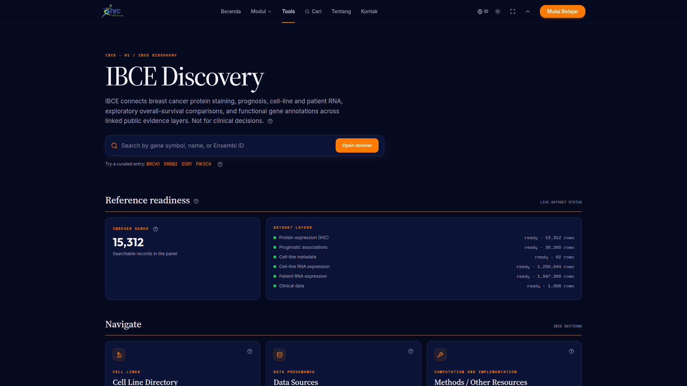
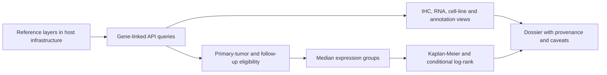

# IBCE: Integrative Breast Cancer Evidence Explorer

**Research software portfolio v1.1.1 | Documentation update only | Selected source, not a standalone application | Not for clinical decisions**

IBCE links breast-cancer protein staining, gene expression, cell-line context, functional annotations and exploratory overall-survival comparisons for source-aware research exploration. The verified project title appears in the existing [project citation record](artifacts/ibios-tools/src/pages/ibios-tools/ibce/integrity-data.ts); it is not a newly invented acronym expansion.

Researcher and portfolio owner: **Mochammad Ichsan**. [Academic website](https://ichsan.ibios.org) · [GitHub](https://github.com/mochammad-ichsan) · [IBIOS](https://ibios.org).

[Live application](https://hrc.ibios.org/ibios-tools/ibce) | [Scientific workflow](docs/portfolio/SCIENTIFIC_WORKFLOW.md) | [Evidence matrix](docs/portfolio/VALIDATION_EVIDENCE.md) | [Limitations](docs/portfolio/LIMITATIONS.md)

The live route was reachable during this audit; that does not establish scientific validity or guarantee continued availability. This portfolio updates documentation around the existing public source snapshot. It does not release newer private application code.



*Actual English IBCE discovery content captured from the running workspace preview on 2026-11-18, not the published deployment. Shared HRC navigation retains some Indonesian labels. Visible aggregate status cards are interface evidence, not independently verified data or analytical correctness. The interface may differ from this source snapshot. The researcher approved redistribution of the original screenshot and requested this English companion. See [approval and provenance](docs/portfolio/assets/README.md), the [original Indonesian capture](docs/portfolio/assets/ibce-public-overview.png), and the [scientific workflow](docs/portfolio/SCIENTIFIC_WORKFLOW.md). No repository publication is authorized by image approval.*

## Scientific motivation and questions

Breast-cancer studies involve heterogeneous molecular evidence [1]. Protein staining, cell-line RNA, cancer-sample RNA and clinical follow-up answer different questions and should not be treated as interchangeable observations. IBCE provides linked, inspectable evidence views rather than a diagnostic classifier.

- **Scientific questions:** How do available protein, RNA and cell-line evidence differ for a selected gene? What descriptive survival patterns occur in an explicitly selected cohort?
- **Computational objectives:** Link gene records, preserve source units and missingness, expose cohort exclusions and display exploratory comparisons.
- **Engineering objectives:** Provide navigable dossiers, provenance, references and inspectable selected methods.
- **Exploratory hypotheses:** Any gene-outcome association is hypothesis-generating, not a confirmed mechanism or treatment recommendation.
- **Validated findings:** This portfolio establishes no new biological discovery, independent external validation or clinical finding.

The Human Protein Atlas is an upstream reference resource [2], not evidence that IBCE's implementation has itself been validated. See [references](docs/portfolio/SCIENTIFIC_WORKFLOW.md#references).

## Computational research framework



The host's data ingestion, database and deployment are not included. This diagram describes implemented paths inspected in source, not an executable pipeline shipped by the repository. There is no verified network-construction, enrichment-testing, docking or predictive-model training pipeline in this selection.

## Researcher Contributions and Development Approach

**Researcher-Led, AI-Assisted Scientific Software Development.** Mochammad Ichsan confirms personally directing the scientific objectives, dataset selection, methodological requirements, feature design and evaluation of results. AI/Replit primarily translated those requirements into code and sometimes suggested scientific, methodological and technical approaches that the researcher evaluated. These are **RESEARCHER_CONFIRMED** statements, not independent reconstruction of the development history.

The [contribution matrix](docs/portfolio/CONTRIBUTIONS.md) distinguishes researcher confirmation, documented artifacts, independently checked narrow numerical evidence and unresolved historical decisions/collaborators. See the [AI disclosure](docs/portfolio/AI_ASSISTED_DEVELOPMENT.md). Neither all ideas nor all code are attributed to manual work by the researcher; no measured AI-code proportion or independent programming assessment is claimed.

## Selected research source

| Inspectable component | Verified relative path | Boundary |
|---|---|---|
| Dossier query and cohort assembly | [routes.ts](artifacts/api-server/src/ibce/routes.ts) | Requires excluded host services and database |
| Cohort eligibility, median split, log-rank | [survival-analysis.ts](artifacts/api-server/src/ibce/survival-analysis.ts) | Pure selected computations; no underlying patient data |
| Synthetic survival tests | [survival-analysis.test.ts](artifacts/api-server/src/ibce/survival-analysis.test.ts) | Vitest-dependent, not full application tests |
| Kaplan-Meier chart computations | [km-analysis.ts](artifacts/ibios-tools/src/pages/ibios-tools/ibce/km-analysis.ts) | Pure selected computation |
| Dossier presentation | [dossier.tsx](artifacts/ibios-tools/src/pages/ibios-tools/ibce/dossier.tsx) | Depends on excluded UI infrastructure |
| Methods and bibliography record | [integrity-data.ts](artifacts/ibios-tools/src/pages/ibios-tools/ibce/integrity-data.ts) | Documentation statements are not independent verification |
| Table definitions | [ibce.ts](lib/db/src/schema/ibce.ts) | Schema only; no rows or credentials |

The [original distribution boundary](#original-source-distribution-and-historical-evidence) below remains in force. No dataset or operational module is added by this documentation update.

## Verification, validation and reproducibility

The [evidence matrix](docs/portfolio/VALIDATION_EVIDENCE.md) separates software checks, numerical verification, statistical-method verification, biological validation and external/clinical validation. The [QA record](docs/portfolio-audit/QUALITY_ASSURANCE.md) records exact commands, versions, exits and output records. A new [synthetic SciPy reference check](docs/portfolio-audit/NUMERICAL_REFERENCE.md) is separate from the unreproduced historical ten-gene claim.

One isolated demonstration uses only synthetic arrays and **already public** pure TypeScript modules:

```sh
node --version  # Node.js 24.x with native TypeScript type stripping
node examples/synthetic-survival-demo.mjs
node --test artifacts/ibios-tools/src/pages/ibios-tools/ibce/km-analysis.test.mjs
python3 scripts/validate-portfolio.py
```

No package installation, credentials, biological data, database or application server is needed for those commands. The [demonstration instructions](examples/README.md) specify assertions and expected output. This limited computational reproducibility does **not** make the whole application reproducible or validate real cohorts. The original Vitest suite is a separate, explicitly qualified check.

## Limitations and roadmap

The median cutpoint is exploratory; ties can unbalance groups. Survival results are unadjusted for confounding and multiple testing. Missingness, source units, sample selection, follow-up quality and cohort definitions affect interpretation. Imported HPA prognosis labels and recalculated survival comparisons are different evidence products. AI text is not independent evidence. See [limitations](docs/portfolio/LIMITATIONS.md).

The [roadmap](docs/portfolio/RESEARCH_ROADMAP.md) distinguishes inspected implementation, bounded verified checks, unvalidated functionality and proposed future research. Neither manuscript acceptance/publication nor prospective, external or clinical validation is established here.

## Citation, licensing and review

Use the provisional software citation in [CITATION.cff](CITATION.cff), not an invented DOI or publication. The complete author list and structured name fields still require owner review. Portfolio v1.1.1 is a documentation label, not a software release. No public release or tag was found during this remediation audit; unverified release version/date fields remain omitted.

The existing [PolyForm Noncommercial License 1.0.0](LICENSE.md) remains unchanged. This is source-available software with noncommercial conditions, **not OSI-approved open source**. See [source-use notices](SOURCE_ATTRIBUTION.md); that license does not grant rights to external datasets or third-party materials.

See the public [QA execution record](docs/portfolio-audit/QUALITY_ASSURANCE.md), [numerical reference](docs/portfolio-audit/NUMERICAL_REFERENCE.md), source-use notices and distribution boundary below. Internal review reports, approval conversations and outer review archives are not part of this public selection. The researcher authorized publication of this documentation update; no software release, dataset expansion or application deployment is represented. The reusable [IBIOS Research Software Portfolio Standard v1.0](docs/ibios-portfolio-standard/README.md) is a documentation standard, not an application framework.

## Original source distribution and historical evidence

The following original disclaimer, exclusions and historical evidence are retained. **HISTORICAL_REPORTED:** the ten-gene comparison below is a project-reported historical result, not an independently reproduced result of this portfolio. Its inputs, execution date and supporting raw reference outputs are not established by the public snapshot. New synthetic reference checks do not upgrade that historical claim.

**Status: source-only research code. Not a runnable application or clinical tool.**

This is a selected, source-only snapshot of the IBCE components in the HRC workspace. It is **not a complete application, a database, a reproducible research package, or a runnable deployment**. The original UI depends on shared HRC components and generated clients. The API source refers to operational modules and shared services intentionally absent here; it cannot be compiled or run in isolation. This snapshot is provided for code and method review only, not clinical decisions.

The source paths under `artifacts/` and `lib/` preserve their original workspace locations. No dependency installation or execution instructions are supplied because that would imply a supported standalone application. Check `SOURCE_MANIFEST.sha256` against the actual files to detect changes after review. Original IBCE code in this selection is offered under the [PolyForm Noncommercial License 1.0.0](LICENSE.md); this is a source-available noncommercial license, not an unrestricted open-source license. See `SOURCE_ATTRIBUTION.md` for separate external source-use notices. No biological datasets are included or licensed by this code license.

## Included

- IBCE-specific user-facing pages, panels, navigation, translations, tooltips, and styles from IBIOS Tools, excluding its administrative page.
- Selected IBCE API source for dossier queries, interpretation, annotation, localization, references, and survival analysis, plus synthetic survival and chart tests.
- IBCE database schema definitions, **not** database rows or exports.

## Intentionally excluded

- The rest of the HRC monorepo, shared application bootstraps, packages, credentials, configuration, production environment files, dependencies, and generated bundles.
- Raw or curated biological data, Cellosaurus snapshot records, attached assets, patient/sample-level exports, backups, database dumps, ingestion scripts and operational ingestion/export modules.
- Administrative source and account identities, unpublished manuscripts, figures, internal notes, and other research outputs.
- Permission for commercial use, or any license to third-party datasets and research material.

Some included UI refers to download/admin capabilities, and the included API router imports modules that are excluded above. These references document how the original system is organized; they are not an offer of working endpoints or included data.

## Scientific scope and remaining review

The included survival implementation restricts RNA observations to TCGA sample type 01, handles duplicate and invalid observations explicitly, and uses an exploratory median split, Kaplan-Meier estimates, and an unadjusted log-rank comparison. Sparse-event results are withheld. These are cohort-level analyses, not individual prognoses or causal estimates. Passing synthetic unit tests does **not** establish independent statistical validation of all live cohorts or correction for confounding and multiple testing.

A read-only comparison used SciPy 1.17.1 `scipy.stats.logrank` with `CensoredData` for ten live gene cohorts. All seven displayed API p-values differed from the reference by less than 0.0000002; ERBB2, PTEN, and EGFR withheld their p-values under the sparse-event rule. Synthetic tests also cover invalid observations, median split, exclusions, and chart endpoints. This limited cross-check does not validate every gene, the underlying data, or the analysis design.

Before using this source in research or extending its scope, a reviewer should confirm:

1. Independent validation of any new cohort and of the input data, beyond the ten-gene reference comparison and synthetic tests here.
2. Source attribution and terms for HPA, TCGA/GDC, Cellosaurus, external annotation APIs, and any AI service if corresponding data or services are used.
3. Scientific wording and citations for any claims made using the code. Correcting for confounders and multiple testing is outside the provided analysis.
4. A new file-by-file review and credential/identifier scan of **any additional files** before uploading them. No data export or copied private content may be added without repeating that review.

Do not infer that this source-only publication endorses an analysis result or supports clinical use.