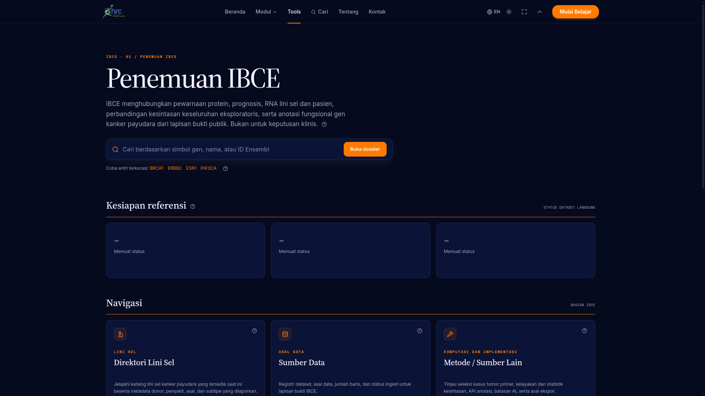

# IBCE project overview

IBCE is the **Integrative Breast Cancer Evidence Explorer**, as named in the existing project citation record. Researcher and portfolio owner: Mochammad Ichsan, [academic website](https://ichsan.ibios.org). Portfolio target: v1.1, documentation candidate for review, not a software release.

## Intended research use

Inspect gene-centered breast-cancer evidence from protein staining, gene expression, cell-line context, functional annotation and exploratory survival comparisons. The purpose is evidence exploration and hypothesis formulation, not individual diagnosis, treatment selection or causal inference.

## What exists

Actual public-interface capture, 2026-11-18; not a mockup or a verified analytical output. Loading placeholders do not establish dataset availability. The live interface can be newer than this selected source. See [visual provenance and approval boundary](assets/README.md).

The public selection includes TypeScript API and UI source, a pure survival computation, a pure Kaplan-Meier chart module, synthetic test files, table definitions and references. The complete host application uses React, TypeScript, Express, PostgreSQL and shared infrastructure; its manifests and bootstraps are intentionally not supplied here. Source inspection supports these architectural statements, not a successful end-to-end run from this repository.

## What this portfolio does not establish

- A new biological finding or clinically validated biomarker.
- Fully reproducible source-to-result analyses on distributed real data.
- Individual authorship of every component.
- Independent confirmation of manuscript acceptance, publication or indexing.

Start with the [README](../../README.md), [workflow](SCIENTIFIC_WORKFLOW.md), [contributions](CONTRIBUTIONS.md) and [evidence matrix](VALIDATION_EVIDENCE.md).
