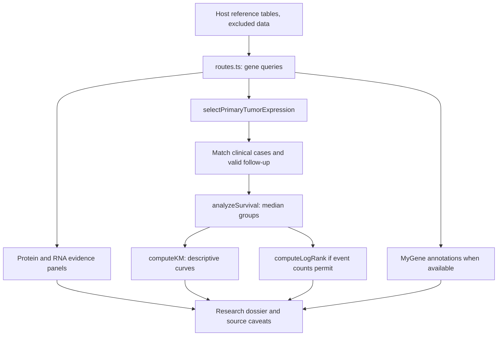

# Scientific workflow and claim-to-evidence map

## Implemented architecture

These are linked branches, not a claim that all modalities are pooled into a single predictive score. Ingestion, data storage and operational services are host dependencies, not released reproducibility components.

| Claim | Inspectable evidence | Evidence boundary |
|---|---|---|
| Gene-linked IHC, prognosis, cell-line and RNA queries | [routes.ts](../../artifacts/api-server/src/ibce/routes.ts) | Code inspected; live data correctness is not established |
| Functional annotation retrieval | [mygene.ts](../../artifacts/api-server/src/ibce/mygene.ts) | External annotation lookup, not newly inferred biological mechanisms |
| Primary solid-tumor sample selection | [survival-analysis.ts](../../artifacts/api-server/src/ibce/survival-analysis.ts), `selectPrimaryTumorExpression` | TCGA-format sample type 01; no upstream data verification |
| Invalid values excluded; identical duplicates collapsed; discordant cases excluded | Same function | Missing expression is not treated as zero |
| Clinical match and overall-survival time | Same file, `analyzeSurvival` | Alive uses positive follow-up; Dead uses positive time to death; unknown status excluded |
| At least 10 analyzed cases and 5 per group | Same file | Eligibility safeguards are not proof of adequate statistical power |
| Arithmetic sample median; high includes ties at the median | Same file | A display convention, not a diagnostic threshold |
| Unadjusted log-rank only when each group has at least 5 events | Same file, `computeLogRank` | Otherwise null, not a zero p-value or evidence of no association |
| Kaplan-Meier steps and bounded curve endpoints | [km-analysis.ts](../../artifacts/ibios-tools/src/pages/ibios-tools/ibce/km-analysis.ts) | Descriptive computation; no proportional-hazards model or covariate adjustment |
| Source units and provenance explanations | [integrity-data.ts](../../artifacts/ibios-tools/src/pages/ibios-tools/ibce/integrity-data.ts) | Existing documentation claims require separate dataset-level verification |

## Interpretation rules

Do not combine HPA prognosis categories with the recalculated survival test as though they were independent replications. Keep pTPM/nTPM labels source-specific; a field name alone does not validate the upstream metric. Record gene, input version, eligibility counts and exclusions for any research result. No actual cohort findings are generated by this portfolio update.

No verified network construction, statistical enrichment, molecular docking, treatment-response prediction or clinical decision model is added or claimed.

## References

1. The Cancer Genome Atlas Network (2012). Comprehensive molecular portraits of human breast tumours. *Nature*, 490, 61-70. [DOI](https://doi.org/10.1038/nature11412). Supports biological context, not validation of IBCE.
2. Uhlen, M., Fagerberg, L., Hallstrom, B.M. et al. (2015). Tissue-based map of the human proteome. *Science*, 347, 1260419. [DOI](https://doi.org/10.1126/science.1260419). Supports upstream HPA context.
3. Kaplan, E.L. and Meier, P. (1958). Nonparametric estimation from incomplete observations. *Journal of the American Statistical Association*, 53, 457-481. [DOI](https://doi.org/10.1080/01621459.1958.10501452). Methodological reference, not software verification.

Existing bibliography and source notices are retained in [SOURCE_ATTRIBUTION.md](../../SOURCE_ATTRIBUTION.md) and the released [bibliography record](../../artifacts/ibios-tools/src/pages/ibios-tools/ibce/integrity-data.ts). Additional source terms must be reviewed before redistributing any data.
